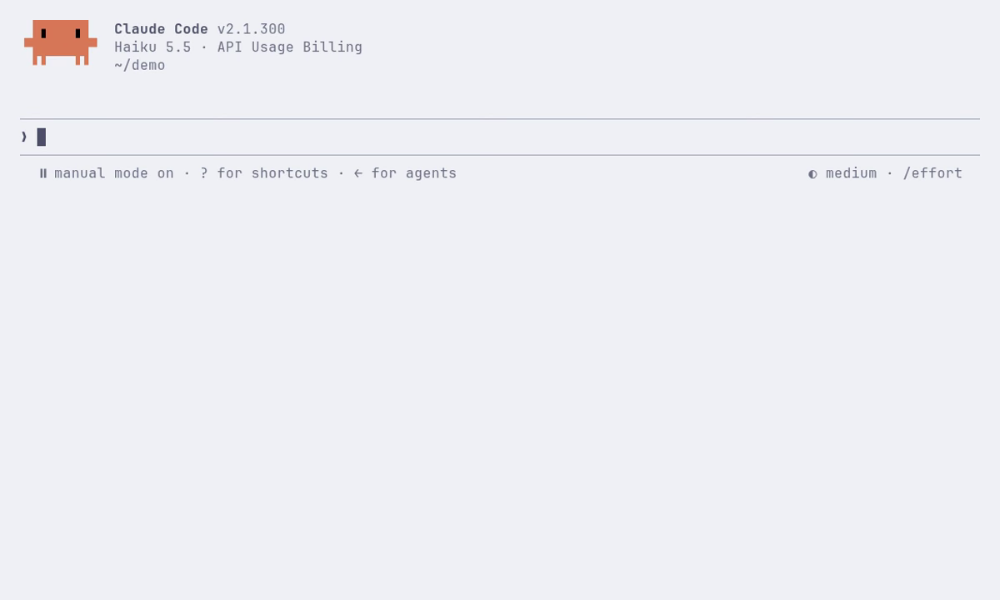
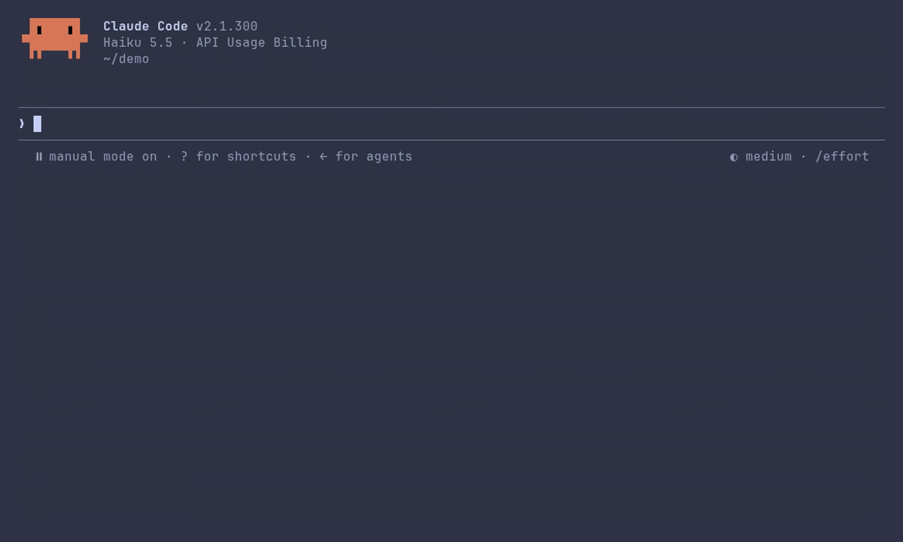
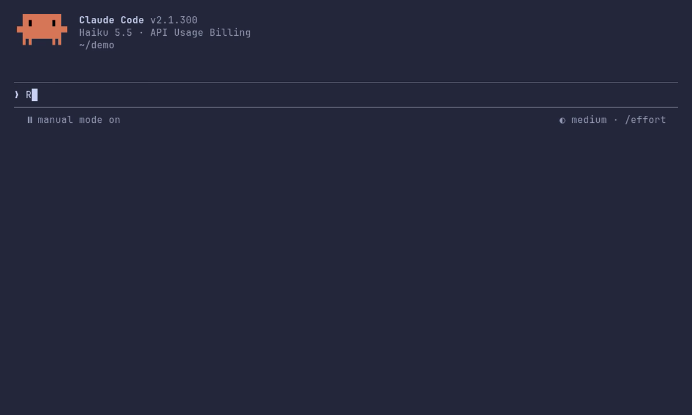
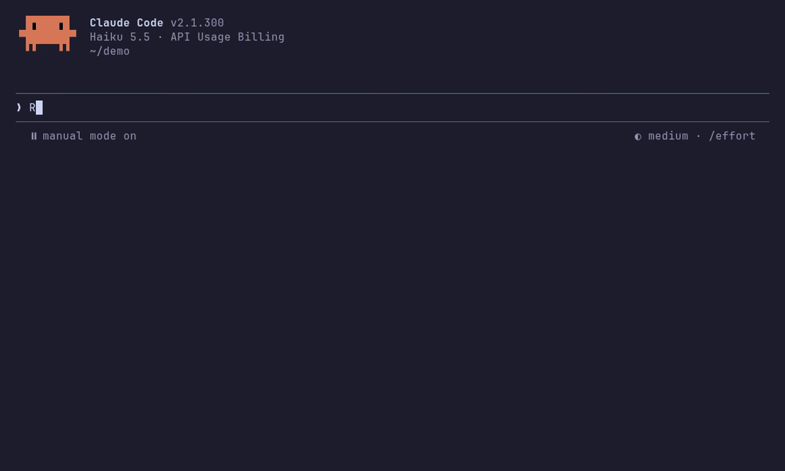

# Catppuccin for Claude Code

The four [Catppuccin](https://catppuccin.com) flavors as Claude Code themes. Every color is set except the mascot's.

| Theme | Base |
| --- | --- |
| Catppuccin Latte | light |
| Catppuccin Frappé | dark |
| Catppuccin Macchiato | dark |
| Catppuccin Mocha | dark |

| Latte | Frappé |
| --- | --- |
|  |  |
| **Macchiato** | **Mocha** |
|  |  |

## Requirements

- Claude Code 2.1.118 or later, in a terminal. Themes color Claude Code's terminal interface, including in the VS Code and JetBrains terminals.
- git on your `PATH`: Claude Code clones the marketplace with it. On Windows, install [Git for Windows](https://gitforwindows.org).
- 24-bit color shows the exact palette. Claude Code uses it when the terminal sets `COLORTERM=truecolor`, as most do; otherwise it rounds every color to the nearest of 256, and the themes keep them distinct there. Terminal.app has 24-bit color from macOS 26: if it doesn't set `COLORTERM` for you, add `export COLORTERM=truecolor` to your shell profile.

## Install

At the prompt of a Claude Code terminal session (2.1.275 or later):

```
/plugin install catppuccin --marketplace mkutlak/claude-code-catppuccin
```

Answer `y` to add the marketplace, then pick a scope.

From a shell (2.1.292 or later):

```
claude plugin install catppuccin --marketplace mkutlak/claude-code-catppuccin
```

On an older Claude Code, add the marketplace first:

```
/plugin marketplace add mkutlak/claude-code-catppuccin
/plugin install catppuccin@catppuccin
```

## Use

Run `/theme` and pick a flavor, or set it in `settings.json`:

```json
{ "theme": "custom:catppuccin:catppuccin-mocha" }
```

Claude Code does not change your terminal's own background, so use the same flavor in your terminal; Catppuccin has [themes for most terminals](https://catppuccin.com/ports). Mocha on a white terminal, or Latte on a black one, is hard to read.

## Updating

Claude Code does not auto-update plugins from third-party marketplaces unless you turn it on, in `/plugin` under Marketplaces. To update by hand:

```
claude plugin update catppuccin@catppuccin
```

## How the colors are picked

Each token gets the role the [Catppuccin style guide](https://github.com/catppuccin/catppuccin/blob/main/docs/style-guide.md) gives it. Where the guide has no role, or its role does not read well in a terminal:

- Claude's accent is Peach, so Claude stays orange. The mascot keeps Claude Code's own colors.
- Diff backgrounds are built in OKLCH, stepping from Base toward Text. The guide's 20% Green or Red over Base comes out grey, so added and removed lines would look alike.
- Dim text is Overlay 2 (Subtext 0 on Latte), not the guide's Overlay 1, which is too faint on a user message's background.
- Auto-accept and bash mode have no role in the guide, so they keep the hue of Claude Code's own dark theme.
- A terminal without 24-bit color rounds every color to its 256-color palette. Seven colors are nudged by about the smallest visible step, so pairs like Claude's orange and the warning yellow still round to different colors.

## Changing the themes

The files in `themes/` are generated. Edit the mapping in `tools/gen.py`, then run it with Python 3.10 or later:

```
python3 tools/gen.py
claude plugin validate .
claude --plugin-dir .
```

CI fails a pull request whose `themes/` does not match `tools/gen.py`.

To record the animations in `assets/` again, put `ANTHROPIC_API_KEY=...` in a file outside the repo and run the recording in Docker. Each flavor is a short Claude Code session on Haiku:

```
docker build -t cc-demo tools/demo
docker run --rm -u "$(id -u):$(id -g)" --env-file ~/path/to/key.env -v "$PWD:/src:ro" -v "$PWD/assets:/out" cc-demo
```

## Releasing

Versions follow [semver](https://semver.org), read from [Conventional Commits](https://www.conventionalcommits.org): `fix:` makes a patch release, `feat:` a minor one, and `feat!:` or a `BREAKING CHANGE:` footer a major one. On each push to `main`, [release-please](https://github.com/googleapis/release-please) keeps a release PR open that bumps `version` in `.claude-plugin/plugin.json` and updates `CHANGELOG.md`. Merging it tags `vX.Y.Z` and publishes the GitHub release. Installed copies only pick up a new version.

## Credits

Colors from [catppuccin/palette](https://github.com/catppuccin/palette) (MIT).

## License

[MIT](LICENSE)
